# HospitalMS

A server-rendered hospital management application for managing patients, doctors, staff accounts, doctor schedules, and appointments. Built with ASP.NET Core MVC, Entity Framework Core, ASP.NET Core Identity, and SQL Server.


## Table of Contents

- [Overview](#overview)
- [Architecture](#architecture)
- [Technology Stack](#technology-stack)
- [Project Structure](#project-structure)
- [Implemented Patterns](#implemented-patterns)
- [Features](#features)
- [Authentication and Authorization](#authentication-and-authorization)
- [MVC Routes and JSON Actions](#mvc-routes-and-json-actions)
- [Database Design](#database-design)
- [Configuration](#configuration)
- [Prerequisites and Setup](#prerequisites-and-setup)
- [Database Migrations and Seeding](#database-migrations-and-seeding)
- [Running the Application](#running-the-application)
- [Testing](#testing)
- [Screenshots](#screenshots)
- [Known Limitations](#known-limitations)
- [Recommended Future Improvements](#recommended-future-improvements)

## Overview

HospitalMS is an ASP.NET Core MVC web application organized into presentation, business logic, and data access projects. Its primary user interface is Razor views rendered by the server. Selected appointment workflows also use JSON/AJAX actions.

The solution targets .NET 10 and persists application and ASP.NET Core Identity data in SQL Server. Identity cookies are used for browser sign-in. The application includes role management and permission claims used by authorization policies.

## Architecture

The solution follows a **layered architecture**. Project references show that the presentation layer depends on both BLL and DAL, and BLL depends on DAL. This is not a strict Clean/Onion Architecture with inward-only dependencies.

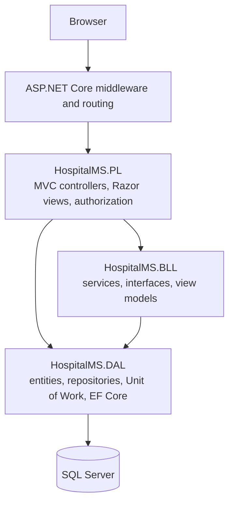

A typical application request follows this path:

> Browser → ASP.NET Core pipeline → MVC controller → BLL service → repository/Unit of Work → `HospitalDbContext` → SQL Server → view or JSON response

Identity workflows also use ASP.NET Core Identity managers and its EF Core store.

## Technology Stack

| Technology | Use in this repository |
|---|---|
| C# / .NET 10 | All application and test projects target `net10.0`. |
| ASP.NET Core MVC and Razor | Web host, MVC controllers, server-rendered views, and conventional routing. |
| Entity Framework Core 10 | ORM, SQL Server provider, entity configurations, and migrations. |
| SQL Server | Relational database provider configured by the `DefaultConnection` connection string. |
| ASP.NET Core Identity | User and role stores, password sign-in, role management, claims, and reset/activation tokens. |
| Cookie authentication | Browser sign-in through Identity; application cookie is configured in `HospitalMS.PL/Program.cs`. |
| Bootstrap, jQuery, JavaScript, CSS | Local frontend assets under `HospitalMS.PL/wwwroot/`. |
| Test tooling | `HospitalMS.BLL.Tests` uses `xunit` 2.9.3, `xunit.runner.visualstudio` 3.1.4, `Microsoft.NET.Test.Sdk` 17.14.1, Moq 4.21.0, MockQueryable.Moq 10.0.13, `Microsoft.Data.Sqlite` 10.0.14, `Microsoft.EntityFrameworkCore.InMemory` 10.0.14, `Microsoft.EntityFrameworkCore.Sqlite.Core` 10.0.14, and `coverlet.collector` 6.0.4. |

Services map entities to view models manually. No AutoMapper/Mapster, FluentValidation, JWT bearer setup, Swagger/OpenAPI, or separate frontend application was found in the inspected source.

## Project Structure

```text
HospitalMS.slnx
├── HospitalMS.PL/                 ASP.NET Core MVC host and presentation layer
│   ├── Authorization/             Permission policy provider and handler
│   ├── Controllers/                MVC endpoints and request handling
│   ├── Views/                      Razor views
│   ├── TagHelpers/                 Permission-aware Razor tag helper
│   └── wwwroot/                    CSS, JavaScript, libraries, and image assets
├── HospitalMS.BLL/                 Application/business layer
│   ├── Authorization/              Permission identifiers
│   ├── Common/                      Service result and service registrations
│   ├── ModelVM/                     MVC input/output view models
│   ├── Seeding/                     Identity and Development demo data seeders
│   └── Service/                     Service abstractions and implementations
├── HospitalMS.DAL/                 Persistence and data access layer
│   ├── Configurations/              EF Core entity configurations
│   ├── Database/                    HospitalDbContext
│   ├── Migrations/                  EF Core migration and model snapshot
│   ├── Models/                      Domain and Identity entities
│   ├── Repositories/                Repository interfaces and implementations
│   └── UnitOfWorks/                 Unit of Work abstraction and implementation
└── HospitalMS.BLL.Tests/            xUnit service test project
    ├── Global/                      Global using directives
    ├── Helper/                      Async query-provider test helpers
    └── Services/
        ├── Account/                 Account, role, permission, and user-account tests
        ├── AppointmentTests/        AppointmentServiceTests
        ├── DoctorTests/             Doctor, schedule, department, and specialty tests
        ├── PatientTests/            PatientServiceTests
        └── ReceptionistTests/       ReceptionistServiceTests
```

## Implemented Patterns

| Pattern or practice | Implementation |
|---|---|
| Layered architecture | Presentation (`PL`), business logic (`BLL`), and persistence (`DAL`) projects. |
| Service Layer | Service interfaces and implementations, such as `IAppointmentService` / `AppointmentService`, mediate between controllers and data access. |
| Repository | Entity-specific repositories such as `IPatientRepository` / `PatientRepository` encapsulate EF Core operations. |
| Generic repository contract | `IRepository<T>` defines common CRUD operations; concrete repositories remain entity-specific. |
| Unit of Work | `IUnitOfWork` / `UnitOfWork` aggregates repository access and exposes saving and transaction operations. |
| Dependency Injection | Services and repositories are registered through `AddServices()` and `AddRepositories()`. Most application registrations are scoped. |
| View-model/DTO-style boundary | `ModelVM` types represent MVC input/output data; mapping is performed manually in services. |
| Permission-based authorization | A custom policy provider and handler evaluate permission claims. |

The codebase does not show CQRS, Mediator, Specification, Strategy, or a dedicated generic repository implementation. It uses framework options for Identity token lifetime, but no project-specific strongly typed options model was found.

## Features

- **Accounts:** Sign-in/sign-out, account activation, forgot-password request, and password reset workflows.
- **User administration:** Create and edit accounts, assign roles, link accounts with doctor/receptionist records, view account summaries, and manage account status.
- **Roles and permissions:** Manage roles and configure permission claims through an administrative permission matrix.
- **Patient records:** Search, list, view, create, update, and soft-delete patient records.
- **Doctor records:** Search, list, view, create, update, and soft-delete doctor records.
- **Doctor schedules:** Configure recurring days and times, detect overlapping schedules, and manage schedules.
- **Departments and specialties:** Browse and manage department and specialty records.
- **Appointments:** Create, filter, view, edit, cancel, check in, mark no-show, and soft-delete appointments. Includes patient lookup and available-slot JSON actions.
- **Doctor dashboard:** View a doctor-specific appointment queue and complete checked-in appointments.
- **Pagination and search:** Several management pages use paged lists and search/filter inputs.

The implementations are in `HospitalMS.PL/Controllers/`, `HospitalMS.BLL/Service/Implementation/`, and the corresponding view models and repositories.

## Authentication and Authorization

The application configures ASP.NET Core Identity with `ApplicationUser` and `ApplicationRole`, backed by `HospitalDbContext`. Successful browser sign-in uses an Identity application cookie. The configured cookie has a 14-day expiration with sliding expiration. Data-protection token lifetime is configured as three days.

Authorization combines:

- Role checks, including the `SuperAdmin` role for role and permission administration.
- Dynamic permission policies backed by `permission` claims. Permission identifiers are defined in `HospitalMS.BLL/Authorization/Permissions.cs` and evaluated by `PermissionPolicyProvider` and `PermissionHandler` in `HospitalMS.PL/Authorization/`.
- Antiforgery validation on many form POST actions.

The identity seeder creates starter roles and a bootstrap administrator. The bootstrap credential is defined in source code; do not use that development seed credential in a production deployment. Replace the provisioning approach with secure, environment-appropriate account creation before deploying.

## MVC Routes and JSON Actions

This application is primarily an MVC web application, not a documented REST API. It uses the conventional route `/{controller=Dashboard}/{action=Index}/{id?}`. Login also has the explicit `/login` route. The table below lists action names and HTTP methods; most actions use the conventional route, and several actions rely on MVC route-value binding rather than a dedicated route template.

| Controller | Actions (HTTP methods) | Notes |
|---|---|---|
| `AccountController` | `Login` (GET, POST), `Logout` (POST), `AccessDenied` (GET), `ActivateAccount` (GET, POST), `ForgotPassword` (GET, POST), `ResetPassword` (GET, POST) | Login is explicitly routed to `/login`; account endpoints allow anonymous access. |
| `DashboardController` | `Index` (GET), `Error` (GET) | `Index` requires authentication; `Error` allows anonymous access. |
| `UserController` | `Index`, `Details`, `Create`, `Edit`, `UpdateStatus`, `GenerateActivationLink`, `GeneratePasswordResetLink` | GET/POST behavior varies by action; administrative actions use `Users.*` policies. Link-generation actions return JSON. |
| `RoleController` | `Index`, `Create`, `Edit`, `Details` | Role management is restricted to `SuperAdmin`. |
| `PermissionsController` | `Index` (GET, POST) | Permission matrix is restricted to `SuperAdmin`. |
| `PatientController` | `Search`, `SelectForAppointment`, `Index`, `Details`, `Create`, `Edit`, `Delete` | `Search` returns a partial view. Core actions use patient or appointment permission policies. |
| `DoctorController` | `Index`, `Details`, `Create`, `Edit`, `Delete` | Uses doctor permission policies. |
| `DoctorScheduleController` | `Index`, `Details`, `Create`, `Edit`, `Delete` | Uses the `Doctors.Schedule` policy. |
| `ReceptionistController` | `Index`, `Details`, `Create`, `Edit`, `Delete` | Uses receptionist permission policies. |
| `DepartmentController`, `SpecialtyController` | `Index`, `Details`, `Create`, `Edit`, `Delete` | Uses settings view/manage policies. |
| `AppointmentController` | `Index`, `GetAvailableSlots`, `Create`, `CreateByPatient`, `SearchPatients`, `QuickCreatePatient`, `PatientAppointments`, `Delete`, `DeleteApp`, `Edit`, `Details`, `GetDoctorsByDepartment`, `NoShowAjax`, `CancelAjax`, `CheckInAjax` | Mix of Razor views, redirects, and JSON responses. Only selected actions specify appointment permission policies. |
| `DoctorDashboardController` | `Index` (GET), `Complete` (POST) | Completion checks that the appointment belongs to the signed-in doctor. |

No Swagger/OpenAPI document, API versioning, or JWT bearer authentication configuration was found. JSON responses are action-specific; a shared REST response/error contract is not implemented.

## Database Design

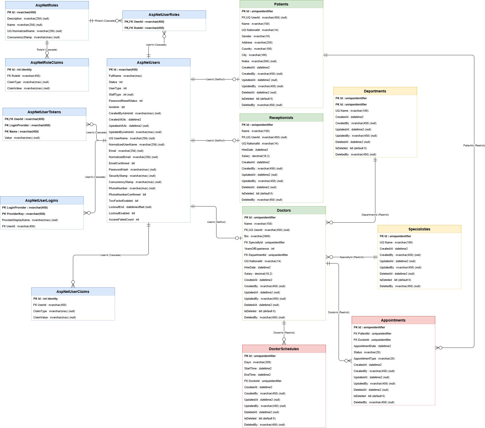

Editable source: [HospitalMS-ERD.drawio](docs/database/HospitalMS_ERD.drawio)

`HospitalDbContext` is an EF Core `IdentityDbContext` with application sets for patients, doctors, receptionists, departments, specialties, doctor schedules, and appointments. Entity configuration is centralized in `HospitalMS.DAL/Configurations/`. The physical specialty table is currently named `Specialisties` in `SpecialtyConfiguration`.

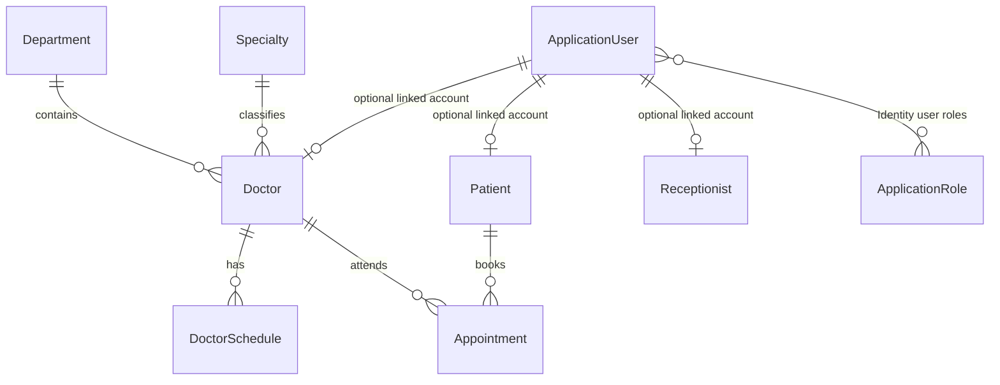

Domain entities use client-generated `Guid` identifiers and inherit common audit/soft-delete fields from `BaseEntity`. Identity entities use string identifiers. The principal entity relationships are:

- One department to many doctors; one specialty to many doctors.
- One doctor to many schedules and appointments.
- One patient to many appointments.
- Optional one-to-one links between an Identity user and a doctor, patient, or receptionist record.

The model uses foreign keys and delete restrictions for appointment, doctor, schedule, department, and specialty relationships. Unique filtered indexes cover active department/specialty names and national IDs; appointment data has a doctor/date index. Identity tables and indexes are also created by the migration.

Soft-deleted domain rows have `IsDeleted`, `DeletedAt`, and `DeletedBy` fields. `BaseEntityConfiguration` applies a global query filter for non-deleted entities. Creation/update audit fields are also present. The initial migration is `20261124231821_initCreate` under `HospitalMS.DAL/Migrations/`.

## Configuration

The web project reads the SQL Server connection from the `ConnectionStrings:DefaultConnection` configuration key. Configure it using user secrets or deployment environment configuration rather than committing credentials. For example, when using a Windows identity with SQL Server integrated authentication, an environment variable can override the setting:

```text
ASPNETCORE_ConnectionStrings__DefaultConnection="Server=YOUR_SQL_SERVER;Database=Hospital_DB;Integrated Security=True;TrustServerCertificate=False;"
```

An `appsettings.json` shape with a placeholder (not a usable credential) is:

```json
{
  "ConnectionStrings": {
    "DefaultConnection": "<configure-through-user-secrets-or-environment>"
  },
  "AllowedHosts": "<your-hostnames>"
}
```

The checked-in configuration currently contains a local SQL Server connection setting. Replace it for your environment. The project also has `Logging` settings in `appsettings.json` and `appsettings.Development.json`; `launchSettings.json` defines local HTTP/HTTPS development profiles.

## Prerequisites and Setup

- .NET 10 SDK.
- A SQL Server instance accessible to the application.
- A database login/identity with permission to create or update the target database, because application startup applies EF Core migrations.

From the repository root:

```powershell
dotnet restore .\HospitalMS.slnx
dotnet build .\HospitalMS.slnx
```

Before starting the web project, configure `ConnectionStrings:DefaultConnection` using a secure local or deployment configuration source.

## Database Migrations and Seeding

On application startup, `HospitalMS.PL/Program.cs` creates a service scope, runs `db.Database.Migrate()`, and then invokes `IIdentitySeeder.SeedAsync()`. With a valid SQL Server connection and database permissions, the initial migration is applied automatically; no separate migration command is required for the standard startup path.

The migration source and model snapshot are in `HospitalMS.DAL/Migrations/`. EF Core design/tools dependencies are declared in the project files. If you choose to manage migrations manually, use EF Core tooling compatible with the installed .NET/EF Core versions and the DAL startup configuration. Review migrations before applying them to shared or production databases.

The seeder creates starter roles, assigns permission claims, and creates a bootstrap administrator if the configured seed user is absent. Treat this as a development/bootstrap mechanism: the credential is hard-coded in the current source and must be replaced with a secure production provisioning method before deployment.

## Running the Application

From the repository root, after configuring the database connection:

```powershell
dotnet run --project .\HospitalMS.PL\HospitalMS.PL.csproj
```

The checked-in launch profiles use `http://localhost:5219` and `https://localhost:7103` (with HTTP also enabled). The application applies migrations and runs identity seeding when it starts.

## Testing

### Overview

`HospitalMS.BLL.Tests` contains unit tests for business-layer services. The tests exercise service behavior with mocked dependencies and isolated in-memory data stores; they do not constitute controller, end-to-end, or SQL Server integration tests. Running the test project currently discovers **451 tests**.

### Framework and libraries

The test project targets `net10.0` and references `xunit` 2.9.3, `xunit.runner.visualstudio` 3.1.4, `Microsoft.NET.Test.Sdk` 17.14.1, Moq 4.21.0, MockQueryable.Moq 10.0.13, `Microsoft.Data.Sqlite` 10.0.14, `Microsoft.EntityFrameworkCore.InMemory` 10.0.14, `Microsoft.EntityFrameworkCore.Sqlite.Core` 10.0.14, and `coverlet.collector` 6.0.4. `AccountServiceTestsBase` creates a SQLite in-memory `HospitalDbContext`; `RoleServiceTests` uses EF Core's InMemory provider. Moq and MockQueryable are used to isolate Identity/repository dependencies and queryable behavior.

### Implemented test coverage

| Test class(es) | Methods and scenarios covered |
|---|---|
| `PatientServiceTests` | Paging, search, list/detail mapping, create/update, user assignment, delete, national-ID validation/uniqueness, soft-deleted and missing records, and repository/database failures. |
| `ReceptionistServiceTests` | Paging, list/detail and national-ID lookup, create/update, user assignment, unassigned records, delete, validation, duplicate IDs, missing/deleted records, and repository errors. |
| `DoctorServiceTests` | Paging and mapping, create/update, salary/department/specialty changes, user assignment, unassigned doctors, delete behavior, national-ID validation/uniqueness, missing/deleted records, and persistence failures. |
| `DoctorScheduleServiceTests` | Schedule queries and day parsing, create/update/delete, required values and time-range validation, duplicate days, schedule conflicts, and missing/deleted records. |
| `DepartmentServiceTests`, `SpecialtyServiceTests` | Paging, mapping, create/update/delete, name validation and uniqueness, soft deletion, missing records, and repository/database errors. |
| `AppointmentServiceTests` | Queries, filtering/search/counts, create/update/change doctor, status updates, rescheduling, delete/cancel/no-show, appointment conflict handling, and missing/deleted records. |
| `LoginAsyncTests`, `ActivateAccountAsyncTests`, `RequestPasswordResetAsyncTests` | `AccountService` login outcomes and lockout/account status, activation and password-reset flows, success/failure paths, sign-in behavior, and transaction rollback. |
| `UserAccountServiceTests` | User details, status transitions, activation/reset link generation, invalid state and missing-user cases, and Identity update failures. |
| `RoleServiceTests`, `PermissionServiceTests` | Role creation/editing, protected roles, listing/paging/details, permission matrix reads and updates, invalid selections, and Identity-operation failures/rollback. |

The test suite includes successful, validation-failure, not-found, conflict, and exception scenarios across these services. It does not establish coverage for untested behavior elsewhere in the application, and no coverage percentage or minimum coverage threshold is configured here.

### Approach and conventions

Tests are organized by service area under `Services/`, use descriptive method names in `Method_Scenario_ExpectedResult` form, and use xUnit `[Fact]`/`[Theory]` tests. Dependencies are generally isolated with Moq; SQLite in-memory and EF Core InMemory are used for selected service tests. These isolated providers are not substitutes for validating the production SQL Server provider, migrations, or the full application request pipeline.

### Run tests

From the repository root:

```powershell
dotnet test .\HospitalMS.BLL.Tests\HospitalMS.BLL.Tests.csproj
```

For detailed test output:

```powershell
dotnet test .\HospitalMS.BLL.Tests\HospitalMS.BLL.Tests.csproj --logger "console;verbosity=normal"
```

Coverlet collector is included in the test project, and this command was verified to produce a Cobertura report:

```powershell
dotnet test .\HospitalMS.BLL.Tests\HospitalMS.BLL.Tests.csproj --collect:"XPlat Code Coverage"
```

The generated report is written under `HospitalMS.BLL.Tests/TestResults/`; the command collects coverage but does not publish or enforce a coverage threshold.

## Screenshots

### Dashboard

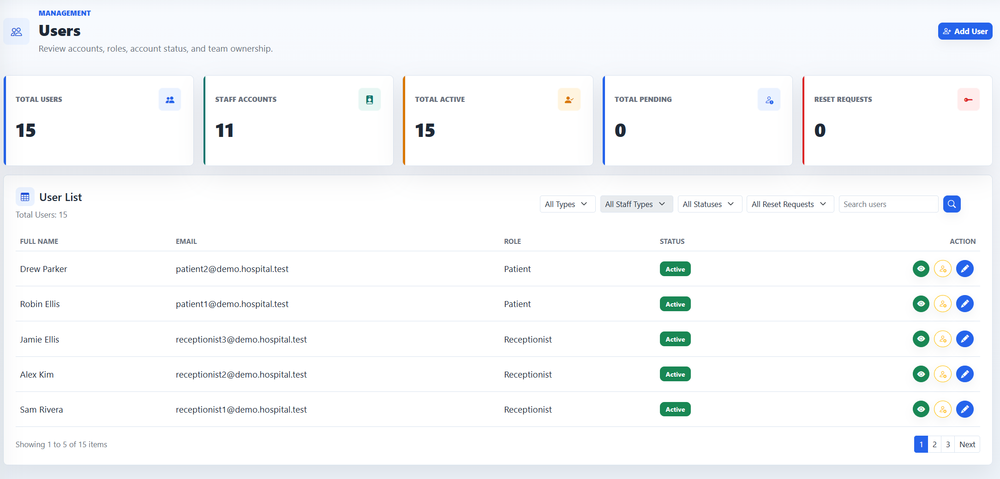

### Users Management

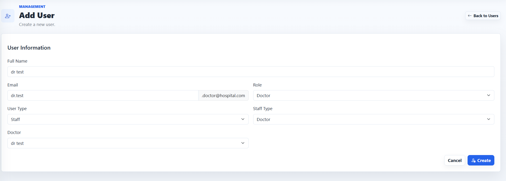

### Patients Management

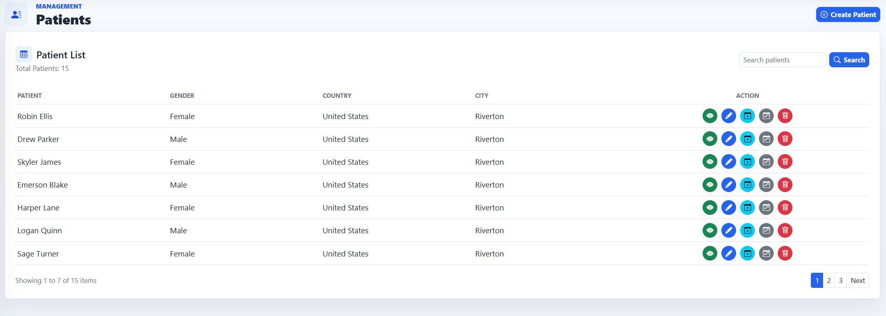

### Doctors Management

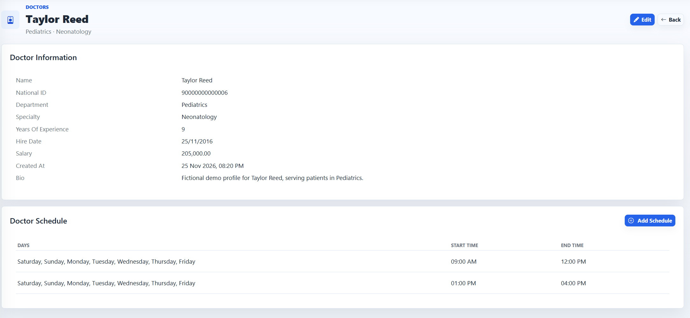

### Appointment Management

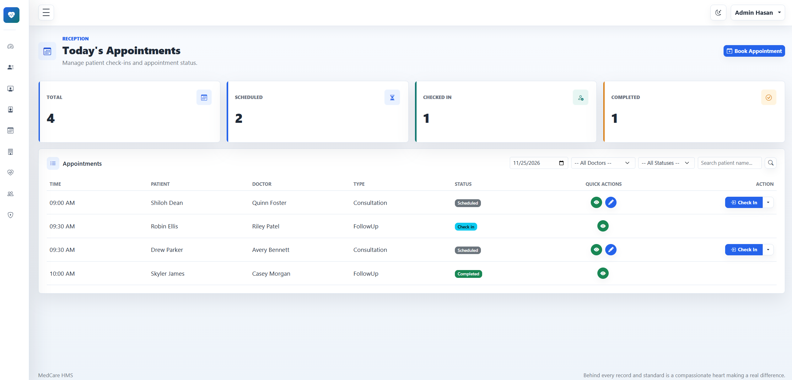

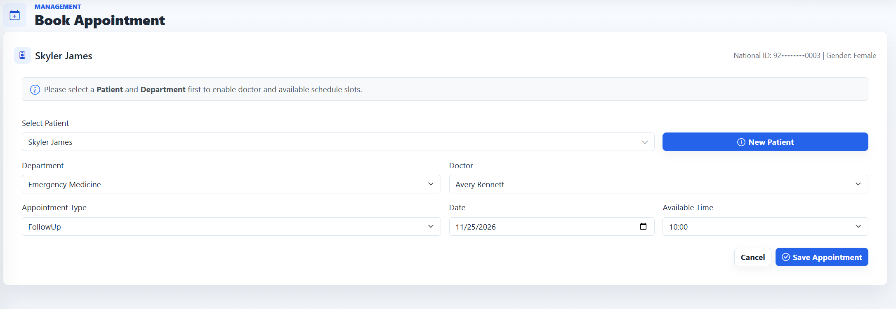

### Roles Management

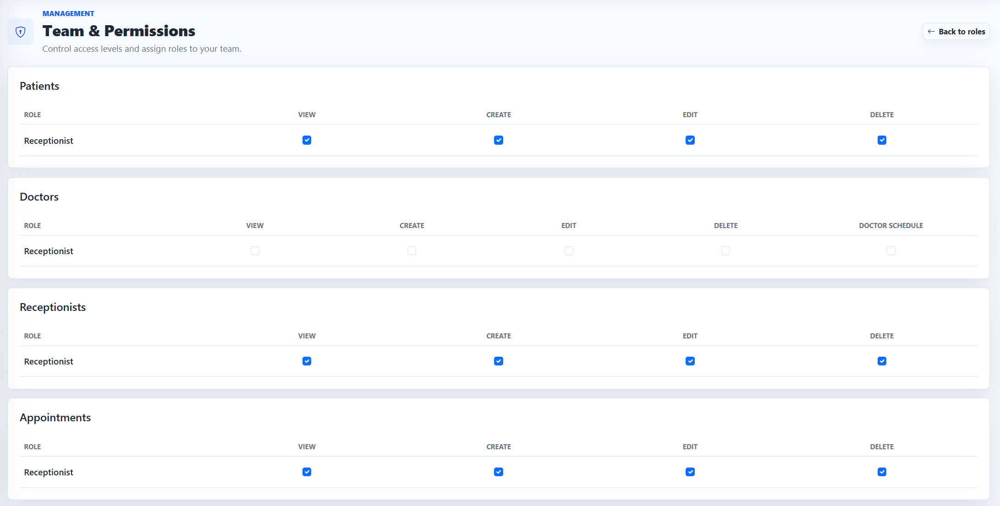

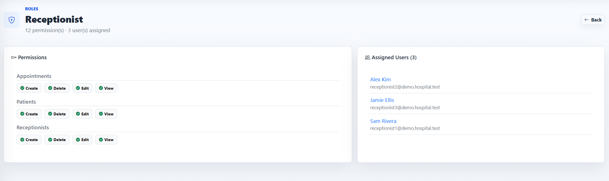

## Known Limitations

- Automated tests currently focus on BLL service behavior; controller/request-pipeline, end-to-end, and production SQL Server integration scenarios are not covered by this test project.
- The bootstrap administrator credential is hard-coded in the identity seeder; do not deploy it as-is.
- Password-reset requests update account state but no email or external notification integration was found.
- Appointment action-level permission checks are inconsistent; some actions require only an authenticated user.
- Appointment creation checks exact-time conflicts but does not fully enforce schedule membership or overlapping appointment duration.
- Patient gender validation does not assign the submitted value to the entity.
- Some doctor/schedule service mappings read navigation properties without corresponding eager loading; schedule update persistence also appears incomplete.
- The repository contains a local-oriented SQL Server setting and `AllowedHosts: "*"`; deployment configuration needs review.
- No Swagger/OpenAPI, JWT bearer setup, Docker configuration, or CI workflow was found.

## Recommended Future Improvements

These items are **recommendations, not features currently implemented**:

1. Replace the hard-coded bootstrap credential with a secure, environment-specific provisioning process and external secret management.
2. Review and apply consistent authorization policies and resource-ownership checks to appointment and patient-related actions.
3. Fix and cover the entity validation, navigation loading, and schedule update behaviors described above.
4. Extend automated tests to controller authorization and request flows, production SQL Server/migration behavior, and end-to-end workflows; retain the existing service-level regression tests.
5. Add an email/notification provider if password-reset and activation links are intended to be delivered to users.
6. Align NuGet package versions across projects and review production connection, host, and TLS settings.
7. Consider documenting a stable API contract or adding OpenAPI only if a public/consumed API is an intended product requirement.
